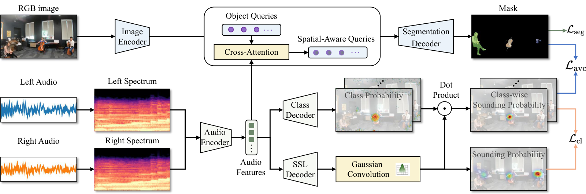
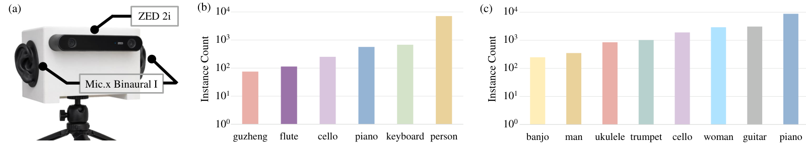

# BiAVIS: Binaural Audio-Visual Instance Segmentation

This is the official implementation for BiAVIS:

> Binaural Audio-Visual Instance Segmentation

# 📋 Abstract

Audio-visual segmentation (AVS) aims to segment sounding objects at the pixel level by integrating auditory and visual cues. Existing methods are predominantly developed under the monaural setting and primarily rely on cross-modal semantic correspondence, which limits their ability to distinguish visually similar instances of the same semantic class. In contrast, humans naturally exploit binaural hearing, where interaural differences and direction-dependent acoustic filtering introduced by the head and pinnae provide physically grounded spatial cues for accurate sound source localization. Motivated by this observation, we introduce binaural audio-visual instance segmentation (BiAVIS), a new task that leverages synchronized binaural audio and video frames to segment sounding instances. To advance research on this task, we establish two benchmarks by manually annotating an existing binaural audio-visual dataset and collecting a new real-world dataset, BiAVIS-Bench, in more challenging and diverse scenarios. The proposed BiAVIS model (BiAVISM) features an audio-only sound source localization network that directly projects binaural spatial cues onto the image plane to learn spatial and semantic priors for sounding instances. A query-level audio-visual fusion strategy is subsequently introduced to inject these informative priors into the instance segmentation decoder. Extensive experiments conducted on the two proposed benchmarks demonstrate the superior performance of BiAVISM over previous monaural AVS methods, especially in resolving instance-level intra-class ambiguity. On the more challenging BiAVIS-Bench, BiAVISM achieves 26.65 mAP and 45.90 FSLA, corresponding to relative improvements of approximately 35.35% over AVISM in mean average precision (mAP) and 11.62% over ACVIS in frame-level sound localization accuracy (FSLA).

# 🪧 Overview

- To the best of our knowledge, this is the first work to formulate binaural audio-visual instance segmentation (BiAVIS), which exploits human-like binaural spatial cues to resolve instance-level intra-class ambiguity that remains challenging for monaural AVIS methods.
- Two benchmarks are established for BiAVIS. FAIR-Play is annotated with instance-level sounding-object labels, and a new real-world benchmark, BiAVIS-Bench, is collected using a binocular camera and a human-like binaural recording device across diverse acoustic and visual environments.
- A dedicated audio-only binaural sound source localization network is designed to directly project binaural spatial cues onto the image plane as dense sounding and class probability maps. Unlike existing binaural localization methods that rely on visual input or regress low-dimensional source directions, the proposed network learns spatially grounded and category-aware representations from binaural audio alone.
- A class-aware audio-visual consistency objective is formulated to explicitly align instance-mask predictions with the audio-derived priors. Unlike existing AVIS methods that mainly rely on semantic audio conditioning, this objective strengthens the spatial alignment between the predicted instance masks and the binaural priors.

# 💾 Dataset

No public dataset provides instance-level sounding-object masks together with human-like binaural audio. We therefore use two benchmarks. Videos are cut into one-second clips, and only the center frame of each clip is used. Each sounding instance has a pixel mask, a category label, and a sound-source point. A clip contains at most four simultaneous sources.

| Dataset | Videos | Clips | Categories | Sounding instances | Scenes |
| --- | ---: | ---: | ---: | ---: | --- |
| FAIR-Play (annotated) | 1,364 | 13,304 | 8 | 19,164 | Single music room |
| BiAVIS-Bench | 870 | 8,052 | 6 | 8,656 | Indoor, outdoor, and semi-open halls |

BiAVIS-Bench is recorded by a ZED 2i binocular camera and a Mic.x Binaural I microphone, rigidly mounted so that the camera–microphone geometry approximates human eyes and ears. Video is 1,280 × 720 at 30 fps. Binaural audio is 48 kHz, 32-bit. The two streams are soft-synchronized by a shared ROS 2 trigger, with a synchronization error bounded by 10.4 μs. Compared with FAIR-Play, BiAVIS-Bench emphasizes multiple instances of the same category.

Annotations of FAIR-Play and the BiAVIS-Bench release will be made available with the code. Dataset release will follow the consent and privacy constraints described in the paper.
